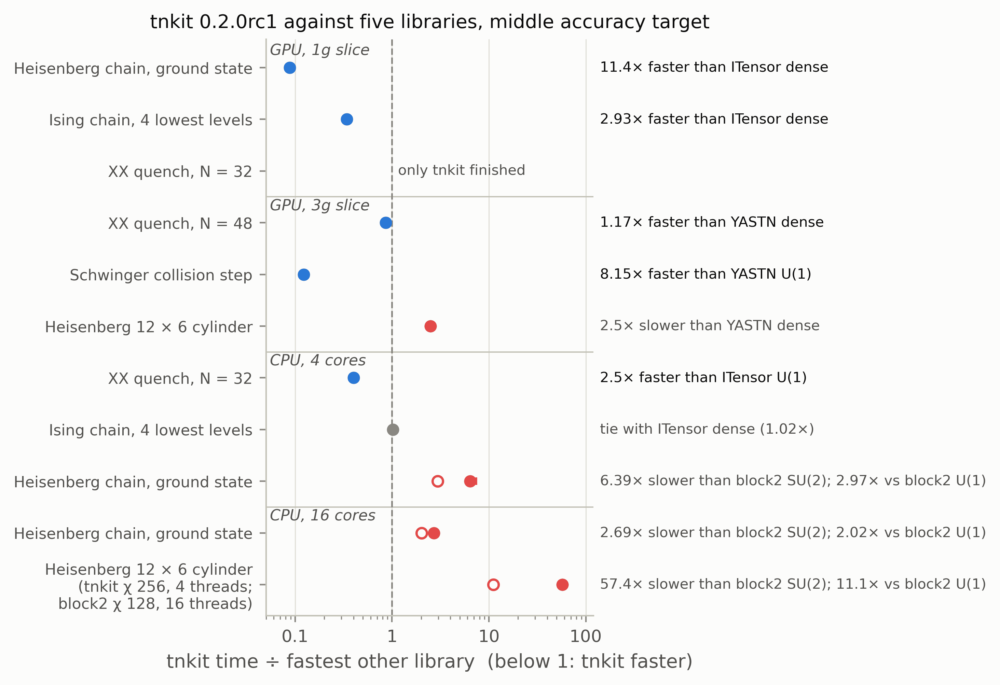

# Benchmarks

tnkit 0.2.0rc1 was timed against ITensor, YASTN, TeNPy, block2 and Quantum TEA on seven workloads,
on two sizes of GPU slice and two CPU allocations. It is the fastest library tested on every
one-dimensional chain workload on a GPU slice, and on its own target workload, a Schwinger-model
collision step. At the sizes tested, though, the chain ground state and the Ising levels ran
faster still on 4 CPU cores, for every library including tnkit; the GPU pays off for time
evolution, the collision step and large bond dimensions. tnkit is not competitive on a
two-dimensional cylinder, or for ground states on the CPU. Both sides are below, with the
conditions that produced them.



*tnkit's fastest time to the middle accuracy target of each row (collision: seconds per step),
divided by the fastest other library's (below 1: tnkit is faster). Bars bound the ratio by the
fastest and slowest of three repeats; most are hidden by the marker; grey marks a tie, where the
bar crosses 1. Hollow markers leave out block2's SU(2) code, which exploits a symmetry the other
libraries do not use. On the 16-core rows each library is taken at its faster thread count and
its best bond dimension, so the cylinder row compares tnkit at χ 256 and 4 threads with block2
SU(2) at χ 128 multiplets and 16 threads.*

## Terms

- **DMRG and TDVP.** DMRG finds ground states (and low excited states) of a matrix product state
  by sweeping over its sites; TDVP evolves one in time. Both are limited by the bond dimension χ,
  the size of the matrices; in time evolution χ is a cap the state may grow up to.
- **MIG slice.** NVIDIA's Multi-Instance GPU splits one H100 into isolated partitions with their
  own compute units and memory. A *1g* slice is one seventh of the card (12 GB); a *3g* slice is
  three sevenths (47 GB). Slices are not shared with other jobs while they run.
- **Dense and U(1).** A dense tensor stores every entry. A U(1) tensor stores only the blocks
  allowed by a conserved charge (here total $S^z$ or particle number), which saves memory and
  work when the blocks are many and small. SU(2) goes further for spin-rotation-invariant
  models; only block2 offers it here, and its bond dimensions count multiplets, not states.
- **Time to accuracy.** For each library and target error ε: the median wall time over three
  repeats at the smallest bond dimension χ whose worst repeat reaches ε. No interpolation. The
  timed region is the whole solve, initial state included. A larger χ can converge in fewer
  sweeps, so a tighter target is occasionally reached sooner.

## Where tnkit is faster

- **Chains, among GPU runs.** On a 1g slice, tnkit reaches $10^{-8}$ relative energy error on the
  Heisenberg chain in 6.77 s, against 76.9 s for ITensor dense (11×; about 3.6× counting only
  ITensor's sweeps after its first, see Caveats). It finds the four lowest Ising levels to
  $10^{-8}$ in 24.5 s, against 71.7 s (ITensor) and 74.0 s (YASTN), 2.9× ahead. On the
  $N = 32$ XX quench it is the only library that finished: both ITensor configurations hit the
  one-hour limit. On a 3g slice, tnkit U(1) reaches $10^{-3}$ on the $N = 48$ quench in 280 s
  (YASTN dense 326 s) and $10^{-4}$ in 410 s (YASTN dense 555 s). Of these, the GPU beats the
  CPU only on the quench: 99.0 s on the 1g slice against 619 s for the fastest 4-core run.
- **The collision step.** On a 3g slice, a time step of the two-flavour Schwinger collision takes
  18.8 s with tnkit's U(1) code, against 153.3 s with YASTN's U(1) code (8.2×) and 78.3 s with
  tnkit's own dense code (4.2×). On a 1g slice, in the default-settings comparison below:
  18.2 s, 148.0 s (8.1×) and 119.1 s (6.5×).
- **CPU time evolution.** On 4 cores, tnkit dense reaches $10^{-3}$ on the $N = 32$ quench in
  619 s, 2.5× ahead of ITensor U(1) (1547 s) and 5.0× ahead of ITensor dense (3078 s).
- **GPU cost per sweep.** tnkit U(1) is the cheapest configuration per DMRG sweep on both slices
  at every bond dimension tried, among runs that reached the accuracy check (table below).

## Where tnkit is slower

- **Small chains on the GPU at all.** The Heisenberg chain ($N = 64$) and the Ising levels
  ($N = 48$) ran faster on 4 CPU cores than on a 1g slice, for every library. To $10^{-8}$ on the
  chain, block2 SU(2) takes 1.17 s, block2 U(1) 2.52 s and ITensor U(1) 6.28 s on 4 cores,
  against tnkit's 6.77 s on the GPU. tnkit itself reaches the Ising target in 5.57 s on 4 cores
  and 24.5 s on the GPU.
- **The 12 × 6 Heisenberg cylinder.** On the same 3g slice, YASTN dense is 2.5× faster to
  $3\times10^{-4}$ (37.6 s against tnkit U(1)'s 94.1 s) and 1.5× faster to $10^{-4}$ (73.6 s
  against 110 s). block2 with SU(2) symmetry on 16 CPU cores reaches every target in 3.97 s (at
  χ 128 multiplets), about 28× sooner than tnkit on the GPU reaches $10^{-4}$.
- **CPU ground states on the chain.** To $10^{-8}$, the fastest library (block2 SU(2)) is 6.4×
  ahead of tnkit on 4 cores (1.17 s against 7.49 s), and 2.4–3.3× ahead on the 16-core
  allocation (at 4 and 16 threads). Without SU(2), block2 U(1) is still 3.0× ahead on 4 cores.
  The gap widens at $10^{-10}$: 12.7 s against 1.17 s on 4 cores.
- **CPU ground states on the cylinder.** To $3\times10^{-4}$ at 4 threads, the U(1) libraries are
  3–9× ahead of tnkit's 228 s: ITensor 74.9 s, TeNPy 44.5 s, YASTN 25.1 s, block2 24.2 s. At
  equal χ 256, block2 SU(2) is 17× ahead at 4 threads (13.6 s) and 22× at 16 threads (11.6 s
  against 258 s). Its smaller χ 128 already reaches every target, in 3.97 s: 65× ahead of tnkit
  at 16 threads, 57× ahead of tnkit's faster 4-thread run.
  tnkit's CPU block-sparse two-site update is the bottleneck: its sweeps at full χ take about
  25 s, against 3.5 s for TeNPy with a similar number of sweeps.
- **A larger GPU slice barely helps.** Going from the 1g to the 3g slice (about 3× the compute)
  speeds tnkit's DMRG sweeps by only 1.0–1.25×, and its U(1) collision step not at all
  (18.2 s on the 1g slice in the default-settings comparison, 18.8 s on the 3g slice). At these
  sizes tnkit is most likely limited by work on the host, not on the GPU.
- **Ising levels on 4 CPU cores** are a tie with ITensor at $10^{-8}$ (5.57 s against 5.45 s,
  overlapping repeat ranges); tnkit is ahead at $10^{-10}$ (11.1 s against 14.6 s).

## The fused two-site matvec (dense DMRG)

Since 0.2.0rc3, dense two-site DMRG applies the effective Hamiltonian with a fused,
transpose-free matvec: one GEMM for the left environment, one batched GEMM for the two MPO
tensors together, one GEMM for the right environment. Results equal the previous matvec to
round-off, not bit for bit. Measured on one NVIDIA H100 NVL MIG 1g.12gb slice, fp64
(scripts and raw outputs in `bench/profile/`):

| MPO (width) | χ | matvec before (ms) | fused (ms) | speed-up | max relative difference |
|---|---|---|---|---|---|
| Heisenberg cylinder, 6 rows (20) | 256 | 2.51 | 1.31 | 1.91× | 2.0e-15 |
| | 512 | 13.20 | 8.35 | 1.58× | 7.3e-15 |
| | 1024 | 99.27 | 63.23 | 1.57× | 1.3e-14 |
| XXZ chain (5) | 256 | 0.75 | 0.32 | 2.34× | 1.5e-15 |
| | 512 | 3.70 | 2.11 | 1.76× | 4.1e-15 |
| | 1024 | 22.38 | 15.31 | 1.46× | 7.1e-15 |

Whole DMRG runs, 8 sweeps at fixed χ, before and after the change:

| system | χ | energy per site | final relative difference | median sweep before → after (s) | speed-up |
|---|---|---|---|---|---|
| Heisenberg 6 × 8 cylinder | 128 | −0.525692671960 | 1.3e-15 | 4.30 → 3.34 | 1.29× |
| | 256 | −0.527150993088 | 7.2e-15 | 14.62 → 10.75 | 1.36× |
| Heisenberg chain, N 64 | 128 | −0.440241013432 | 3.0e-15 | 2.49 → 2.40 | 1.04× |
| | 256 | −0.440241013433 | 1.0e-14 | 5.39 → 5.22 | 1.03× |

The two versions agree at every sweep (largest per-sweep difference 1.2e-14). The gain per sweep
is smaller than the matvec's: on the chain the eigensolver and the SVD dominate a sweep. The
cylinder energies are not converged ground states after 8 sweeps; both versions follow the same
path, which is what the check tests.

## Caveats

- **ITensor's dense CUDA code** spends 37–96 s on its first sweep in each timed run, a one-off
  setup cost inside the timed region; later sweeps take 0.6–15 s. Its dense GPU times therefore
  overstate its steady-state cost. Its U(1) CUDA code is slow on every sweep, not only the
  first. On the 1g chain to $10^{-6}$ its later sweeps alone sum to about 14 s,
  against tnkit's whole run of 7.6 s.
- **The 16-core allocation** was a 16-CPU quota on a shared node with 384 visible CPUs (an AMD
  EPYC 9655 half-node partition), not 16 dedicated cores. On it, TeNPy and YASTN ran 10–61×
  slower at 16 threads than at 4, with the same sweeps and energies: TeNPy 473 s against 7.76 s
  on the chain, YASTN 145 s against 8.62 s. This is most likely an interaction between their
  BLAS threading and the quota, not a property of the libraries, so their 4-thread times are
  the ones quoted. block2 and ITensor gained 1.1–1.5× from 16 threads; tnkit ran 13–22% slower.
- **The 4-core and 16-core rows** ran on different CPU models and are not compared with each
  other.
- **Settings.** Every library ran tuned settings from its own documentation (below), and every
  ground-state run stopped on one shared rule. Faster settings may exist for any library,
  tnkit included.
- **Quantum TEA** ran on the GPU only, in its own Python environment (numpy 2.1.3). TeNPy and
  block2 ran on the CPU only.

## Results

Times in seconds: median of 3 repeats, at the χ shown where it matters. "–" means the library
was not run there (in the sweep-cost table, also that the run was left out). Every cell, with
its repeat range, is in `bench/suite/scored_cells.tsv` in the repository.

**GPU, H100 NVL, 1g slice.** Heisenberg chain $N = 64$; Ising chain $N = 48$ at $g = 1$, error
$\max_k |E_k - E_k^{\rm exact}|/|E_0|$ over the four lowest levels; XX quench $N = 32$ to
$T = 8$, error $\max_i |\langle S^z_i(T)\rangle - \text{exact}|$.

| row | ε | tnkit dense | ITensor dense | ITensor U(1) | YASTN dense |
|---|---|---|---|---|---|
| Heisenberg chain | $10^{-8}$ | **6.77** (χ 64) | 76.9 | 132 | – |
| | $10^{-10}$ | **9.54** (χ 128) | 98.7 | 180 | – |
| Ising, 4 lowest levels | $10^{-8}$ | **24.5** (χ 16) | 71.7 | – | 74.0 |
| | $10^{-10}$ | **18.2** (χ 32) | 106 | – | not reached |
| XX quench, $N = 32$ | $10^{-3}$ | **99.0** (χ 128) | timed out | timed out | – |

**GPU, H100 NVL, 3g slice.** XX quench $N = 48$ to $T = 12$; Heisenberg model on a 12 × 6
cylinder (open along 12, periodic along 6), error against an extrapolated block2 SU(2) energy.

| row | ε | tnkit U(1) | tnkit dense | YASTN dense | YASTN U(1) | Quantum TEA dense | ITensor dense | ITensor U(1) |
|---|---|---|---|---|---|---|---|---|
| XX quench, $N = 48$ | $10^{-3}$ | **280** | 301 | 326 | 1267 | 1765 | timed out | timed out |
| | $10^{-4}$ | **410** | 723 | 555 | not reached | not reached | timed out | timed out |
| Cylinder | $3\times10^{-4}$ | 94.1 | 108 | **37.6** | 98.7 | – | 150 | 716 |
| | $10^{-4}$ | 110 | 168 | **73.6** | 109 | – | 200 | 602 |

**Collision step**, two-flavour Schwinger model, 160 sites, bond cap 256 (seconds per TDVP step,
mean of steps 2–6, median of 3). The 1g row comes from the default-settings comparison below, on
a different machine; time evolution ran each library's defaults in both.

| slice | tnkit U(1) | tnkit dense | YASTN U(1) |
|---|---|---|---|
| 3g | **18.8** | 78.3 | 153.3 |
| 1g | **18.2** | 119.1 | 148.0 |

**Cost per DMRG sweep**, Heisenberg chain $N = 64$, exactly 3 sweeps from a random state at full
χ (seconds per sweep, mean of sweeps 2–3, median of 3). Runs whose energy after 3 sweeps is
more than $10^{-6}$ (relative) above the reference are left out (–): every YASTN dense run
but one, and every ITensor run but one. One left-out run was cheaper per sweep: ITensor dense on
the 3g slice at χ 512, 6.4 s, but $1.3\times10^{-3}$ above the reference after 3 sweeps.

| library | 1g: χ 256 / 512 / 1024 | 3g: χ 256 / 512 / 1024 / 2048 |
|---|---|---|
| tnkit U(1) | **3.94** / **7.78** / **17.3** | **3.95** / **7.48** / **15.7** / **37.2** |
| tnkit dense | 5.36 / 14.9 / – | 4.82 / 11.9 / 38.4 / – |
| Quantum TEA dense | 9.38 / 20.3 / – | 7.63 / 9.67 / 25.2 / – |
| YASTN U(1) | 9.54 / 16.3 / 38.2 | 9.76 / 16.0 / 34.0 / 97.6 |
| YASTN dense | 7.61 / – / – | – |
| ITensor U(1) | – | – / – / – / 43.7 |

Time per sweep rises less than 4× per doubling of χ everywhere, so no configuration is yet in its
asymptotic $\chi^3$ regime and no scaling law is fitted.

**CPU, 4 cores** (AMD EPYC Genoa virtual machine, 4-CPU quota, 4 threads).

| row | ε | block2 SU(2) | block2 U(1) | ITensor U(1) | ITensor dense | tnkit U(1) | tnkit dense | YASTN dense | TeNPy dense |
|---|---|---|---|---|---|---|---|---|---|
| Heisenberg chain | $10^{-8}$ | **1.17** | 2.52 | 6.28 | 9.50 | 7.49 | 21.6 | – | – |
| | $10^{-10}$ | **1.17** | 6.96 | 12.1 | 35.9 | 12.7 | 104 | – | – |
| Ising, 4 lowest levels | $10^{-8}$ | – | – | – | **5.45** | – | 5.57 | 12.5 | 38.0 |
| | $10^{-10}$ | – | – | – | 14.6 | – | **11.1** | 19.5 | 22.6 |
| XX quench, $N = 32$ | $10^{-3}$ | – | – | 1547 | 3078 | – | **619** | – | – |

TeNPy's stop on the Ising row is relative to $\max(|E|, 1)$ and so looser than the others' by
about $|E_0|$.

**CPU, 16-CPU quota** (AMD EPYC 9655, shared node). U(1) for every library except block2 SU(2);
the chain at χ 256 only; the cylinder at 4 threads at χ 256 only.

| row | ε | threads | block2 SU(2) | block2 U(1) | ITensor | TeNPy | YASTN | tnkit |
|---|---|---|---|---|---|---|---|---|
| Heisenberg chain | $10^{-8}$ | 16 | **5.70** | 7.60 | 11.5 | 473 | 145 | 18.7 |
| | | 4 | **6.46** | 9.05 | 13.6 | 7.76 | 8.62 | 15.3 |
| Cylinder | $3\times10^{-4}$ | 16 | **3.97** | 20.5 | 49.4 | 735 | 250 | 258 |
| | | 4 | **13.6** | 24.2 | 74.9 | 44.5 | 25.1 | 228 |
| | $10^{-4}$ | 16 | **3.97** | 57.2 | 97.3 | 1416 | 240 | 608 |

### U(1) blocks at default settings

A separate comparison put tnkit's U(1) code beside YASTN's and TeNPy's at each library's
default settings with the workload's $10^{-10}$ energy stop (no tuning), on the same release, one 1g slice and
one 4-core CPU.

| row | hardware | ε | tnkit U(1) | tnkit dense | YASTN U(1) | TeNPy U(1) |
|---|---|---|---|---|---|---|
| Heisenberg chain | GPU | $10^{-8}$ | 19.5 | **10.2** | 31.5 | – |
| XX quench, $N = 32$ | GPU | $10^{-3}$ | 126 | **98.0** | 709 | – |
| Heisenberg chain | CPU | $10^{-8}$ | 10.4 | 28.8 | **8.28** | 10.9 |
| | | $10^{-10}$ | 14.0 | 107 | 27.4 | **8.39** |
| XX quench, $N = 32$ | CPU | $10^{-3}$ | **123** | 619 | 184 | 262 |

The same comparison timed tnkit's U(1) DMRG against its dense DMRG per sweep, on Heisenberg
chains of 64 and 128 sites. On the GPU, U(1) costs less per sweep at χ 256 (1.6–1.9×) and χ 512
(3.2–3.3×), about the same at χ 128 (0.93–1.08×), and more at χ 32–64 (0.57–0.92×), most likely
because the blocks there are too small to keep the GPU busy.

## Method

**Workloads** (`bench/suite/suite_2.json`). Heisenberg chain ground state ($N = 64$, open,
χ 32–256; reference energy $-28.17542485974319$, agreed by five configurations at χ 512 within
$10^{-12}$). Four lowest levels of the critical Ising chain ($N = 48$, χ 16–128; exact free-fermion
reference). XX quench from a Néel state ($N = 32$ to $T = 8$ at $dt = 0.05$, bond caps 32–256;
and $N = 48$ to $T = 12$ at $dt = 0.1$, bond caps 256–1024; exact free-fermion reference). Heisenberg
12 × 6 cylinder ($N = 72$, χ 256–1024, block2 SU(2) 128–512 multiplets; each library ramps 2 sweeps each at χ/8, χ/4 and χ/2,
then up to 10 at χ; reference from block2 SU(2) at 384–768 multiplets, extrapolated linearly in
the discarded weight, uncertainty $7.9\times10^{-9}$ relative). Fixed-sweep throughput on the
Heisenberg chain. The collision step continues a saved two-flavour Schwinger state; its
correctness check requires every library's site densities to agree with tnkit's within
$10^{-4}$ (YASTN: $1.6\times10^{-6}$).

**Stop rule, fixed before the runs.** Every library ends a chain ground-state run when
$|\Delta E| < 10^{-10}|E|$ between sweeps (block2, whose stop is absolute, at
$10^{-10}|E_{\rm ref}| = 2.8175\times10^{-9}$), and a cylinder run when
$|\Delta E| < 4.6\times10^{-7}$. Time evolution and excited states run each library's
documented defaults. The analysis rules (the time-to-accuracy definition, which runs count, how
references are accepted) were also fixed before any timing run; they are stated at the top of
`bench/suite/analyse2.py`.

**Settings** (`bench/suite/settings_suite2.json`; every run records the settings it used). tnkit:
`rtol=1e-10`, no subspace expansion. YASTN: two two-site sweeps, then one-site, as in its DMRG
examples. Quantum TEA: two-tensor update (`statics_method=6`). TeNPy: two-site with its mixer, as
in its examples. block2: its tutorial's noise schedule. ITensor: noise $10^{-6}, 10^{-7},
10^{-8}$, then 0, Krylov dimension 3, as in its examples. Precision is float64 for DMRG and
complex128 for time evolution in every library.

**Hardware and repeats.** GPU rows ran on NVIDIA H100 NVL MIG slices (1g.12gb and 3g.47gb) with
3 host threads on AMD EPYC 9654 hosts; each of the four GPU machines used a different physical
card. The configurations of one comparison shared one machine and ran interleaved, three
repeats each, with their order rotated every repeat. A tnkit dense control repeated on several
machines agreed within 0.98–1.01 of its own time. Sampling peak memory during the runs changed wall
time by a factor of 0.92–1.01 in 18 checks.

**Versions.** tnkit 0.2.0rc1 (commit 5c1fb1a); YASTN 1.6.1; TeNPy 1.1.1; block2 0.5.4 with MKL
2024.2.2; Quantum TEA (qtealeaves 1.12.6, qredtea 0.4.8); ITensors 0.9.32 with ITensorMPS 0.4.2,
CUDA.jl 6.5.0, cuTENSOR 6.5.0 and Julia 1.13.3 (`bench/suite/jl/Manifest.toml`). Python 3.11.15,
numpy 2.4.6, scipy 1.17.1, PyTorch 2.5.1 with CUDA 12.4, OpenBLAS. Container image digest
`sha256:9a0474ea00feaf967fd04ee3eb58835568ac6ed1ada8757530dea6001bebde03`.

## Reproduce

The harness is `bench/suite/`. `env/build_wheelhouse.sh` and `env/build_wheelhouse_s2.sh` fetch
the hash-pinned wheels and `env/install_env.sh` installs them offline. One machine's share of the
plan then runs with

```bash
python bench/suite/schedule.py --spec bench/suite/suite_2.json --pod <name> --out DIR
```

where `<name>` is one of the machines in `suite_2.json`. Each run is its own process
(`bench/suite/run.py`) and appends one JSON line, with timings, energies, versions and hardware, to
`DIR/runs.jsonl`. Scoring and figures:

```bash
python bench/suite/analyse2.py --spec bench/suite/suite_2.json --runs DIR*/runs.jsonl \
    --out summary.json --table table.md
python bench/suite/headline.py extract summary.json SUMMARY_2U.json --out cells.tsv
python bench/suite/headline.py plot cells.tsv --out benchmarks.png
```

`SUMMARY_2U.json` is `bench/suite/analyse.py`'s summary of `suite_2u.json`, the default-settings
U(1) comparison. Notes:

- **The collision workload needs data that is not distributed.** It starts from a saved state and
  its MPO (`state_gt0020.000.npz`, `mpo.npz`); set `TNBENCH_DATA` to their directory. Without it
  the workload is recorded as unsupported.
- **ITensor** runs in Julia from the committed manifest; point `TNBENCH_JULIA_PROJECT` and the
  related `TNBENCH_JULIA*` variables at it (see `bench/suite/runners/itensor_runner.py`).
- **The settings file's hash.** Each run records the sha256 of the settings file it read,
  `fb203394…337e`. The file shipped here has the same settings, but its `_about` text was
  reworded after the runs, so its hash differs.
- The per-run records are not distributed. `bench/suite/scored_cells.tsv` holds every measured
  cell (median, fastest and slowest repeat) behind the numbers above.

## The eigensolver loop on the device

DMRG spends most of its time in a Lanczos eigensolve. tnkit runs the Krylov loop entirely on the
GPU. The alternative, `scipy.sparse.linalg.eigsh` on the host driving a GPU matrix-vector product
(the architecture of earlier work, reproduced as `tnkit.eigensolver.scipy_host_ground`), sends the
Krylov vector across PCIe on every product. On one H100, open transverse-field Ising chain
$N = 200$, $g = 0.96$, complex128, both runs stopped on the eigensolver residual and pinned to the
same parity sector:

| χ | tnkit | host loop | speed-up | PCIe traffic (host loop) |
|---:|---:|---:|---:|---:|
| 64 | 47.3 s | 55.7 s | 1.18× | 19.7 GiB |
| 128 | 115.7 s | 220.3 s | 1.90× | 96.6 GiB |
| 256 | 249.8 s | 1446.5 s | 5.79× | 556.2 GiB |
| 512 | 920.3 s | 6580.9 s | 7.15× | 2700.9 GiB |

Both runs do the same number of matrix-vector products to within a few percent, so the
difference is where the Krylov vector lives. Accuracy matched: parity $+1.0000$ on both; error
against the exact free-fermion energy $9.7\times10^{-13}$ (tnkit) and $3.3\times10^{-12}$ (host
loop) at χ 512. At χ 256, moving from an L40S to an H100 takes tnkit from 7.16 to 2.83 ms per
product and leaves the host loop unchanged (18.60 to 19.17 ms): it is bound by the bus, not the
card. The driver that produced this table is not part of this repository.

Quote the span, 1.18× to 7.15×, not an exponent. The local exponents across the three doublings
are +1.15, +1.67 and +0.27, so four points cannot separate continued growth from saturation.

**Set the eigensolver stop explicitly when you benchmark.** The energy stop leaves the
eigenvector only $\sqrt{\text{tol}}$ converged, so comparing a run stopped on energy with one
stopped on residual compares two accuracies while looking like a speed measurement.
